# Resultados del análisis estadístico (ANOVA)

Generado por `analisis/anova.py` a partir de `datos_limpios/`. Nivel de significancia: α = 0,05.

## Método

- **Supuestos:** normalidad de los residuos con Shapiro-Wilk (muestra aleatoria de hasta 5.000 datos, semilla 42) y homogeneidad de varianzas con Levene centrado en la mediana.
- **Prueba principal:** ANOVA de un factor si se cumplen ambos supuestos; si no, Kruskal-Wallis. Se reportan las dos para comparar.
- **Tamaño del efecto:** η² para ANOVA y ε² para Kruskal-Wallis. Referencia: < 0,01 despreciable, 0,01–0,06 pequeño, 0,06–0,14 mediano, ≥ 0,14 grande.
- **Post-hoc:** Tukey HSD si la prueba principal es significativa; con Kruskal-Wallis se agrega Mann-Whitney por pares con corrección de Holm.
- **R3** usa solo cocinas con al menos 1000 reseñas y excluye "Sin dato": Spanish (15,728), Mediterranean (10,855), Steakhouse (4,730), Seafood (3,755), Italian (3,066), European (2,210), Coffee & Tea (1,920), Mexican (1,830), Bar (1,246), Japanese (1,183), American (1,102).
- **R1** excluye las reseñas con nivel de precio "Sin dato".
- **Comparaciones múltiples:** el p de la prueba principal se corrige con Holm dentro de cada familia (17 pruebas de la encuesta, 3 de las reseñas). Una prueba solo se considera significativa si lo sigue siendo tras la corrección.
- **Post-hoc:** la diferencia de medias es grupo 2 − grupo 1.

## Resumen

| Código | Pregunta | n | Supuestos (Shapiro / Levene) | Prueba | Estadístico | p | p Holm | Efecto | ¿Significativo? |
|---|---|---:|---|---|---|---|---|---|---|
| E1 | ¿La calificación promedio cambia según la cocina preferida? | 1,500 | ✗ / ✗ | Kruskal-Wallis | H = 1.61 | 0.806 | 1.000 | 0.0000 (despreciable) | No |
| E2 | ¿La calificación promedio cambia según la ocasión? | 1,500 | ✗ / ✓ | Kruskal-Wallis | H = 1.65 | 0.439 | 1.000 | 0.0000 (despreciable) | No |
| E3 | ¿La calificación promedio cambia según la franja de visita? | 1,500 | ✗ / ✓ | Kruskal-Wallis | H = 2.14 | 0.343 | 1.000 | 0.0001 (despreciable) | No |
| E4 | ¿La calificación promedio cambia según la frecuencia de visita? | 1,500 | ✗ / ✓ | Kruskal-Wallis | H = 6.11 | 0.106 | 1.000 | 0.0021 (despreciable) | No |
| E5 | ¿La calificación de servicio cambia según la cocina preferida? | 1,500 | ✗ / ✓ | Kruskal-Wallis | H = 1.89 | 0.755 | 1.000 | 0.0000 (despreciable) | No |
| E6 | ¿La calificación de servicio cambia según la ocasión? | 1,500 | ✗ / ✓ | Kruskal-Wallis | H = 0.93 | 0.627 | 1.000 | 0.0000 (despreciable) | No |
| E7 | ¿La calificación de servicio cambia según la franja de visita? | 1,500 | ✗ / ✓ | Kruskal-Wallis | H = 0.35 | 0.837 | 1.000 | 0.0000 (despreciable) | No |
| E8 | ¿La calificación de servicio cambia según la frecuencia de visita? | 1,500 | ✗ / ✓ | Kruskal-Wallis | H = 6.22 | 0.101 | 1.000 | 0.0022 (despreciable) | No |
| E9 | ¿La calificación de comida cambia según la cocina preferida? | 1,500 | ✗ / ✓ | Kruskal-Wallis | H = 4.29 | 0.368 | 1.000 | 0.0002 (despreciable) | No |
| E10 | ¿La calificación de comida cambia según la ocasión? | 1,500 | ✗ / ✓ | Kruskal-Wallis | H = 0.83 | 0.660 | 1.000 | 0.0000 (despreciable) | No |
| E11 | ¿La calificación de comida cambia según la franja de visita? | 1,500 | ✗ / ✓ | Kruskal-Wallis | H = 3.60 | 0.165 | 1.000 | 0.0011 (despreciable) | No |
| E12 | ¿La calificación de comida cambia según la frecuencia de visita? | 1,500 | ✗ / ✓ | Kruskal-Wallis | H = 10.80 | 0.013 | 0.219 | 0.0052 (despreciable) | Solo sin corregir |
| E13 | ¿La calificación de ambiente cambia según la cocina preferida? | 1,500 | ✗ / ✓ | Kruskal-Wallis | H = 3.70 | 0.448 | 1.000 | 0.0000 (despreciable) | No |
| E14 | ¿La calificación de ambiente cambia según la ocasión? | 1,500 | ✗ / ✓ | Kruskal-Wallis | H = 0.68 | 0.712 | 1.000 | 0.0000 (despreciable) | No |
| E15 | ¿La calificación de ambiente cambia según la franja de visita? | 1,500 | ✗ / ✗ | Kruskal-Wallis | H = 0.12 | 0.941 | 1.000 | 0.0000 (despreciable) | No |
| E16 | ¿La calificación de ambiente cambia según la frecuencia de visita? | 1,500 | ✗ / ✓ | Kruskal-Wallis | H = 0.04 | 0.998 | 1.000 | 0.0000 (despreciable) | No |
| E17 | ¿El tiempo de espera cambia según la franja de visita? | 1,500 | ✗ / ✓ | Kruskal-Wallis | H = 4.12 | 0.128 | 1.000 | 0.0014 (despreciable) | No |
| R1 | ¿El rating cambia según el nivel de precio? | 51,920 | ✗ / ✗ | Kruskal-Wallis | H = 254.32 | < 0.001 | < 0.001 | 0.0049 (despreciable) | Sí |
| R2 | ¿El rating cambia según el año? | 53,382 | ✗ / ✗ | Kruskal-Wallis | H = 93.66 | < 0.001 | < 0.001 | 0.0016 (despreciable) | Sí |
| R3 | ¿El rating cambia según la cocina principal? | 47,625 | ✗ / ✗ | Kruskal-Wallis | H = 1239.57 | < 0.001 | < 0.001 | 0.0258 (pequeño) | Sí |

✓ = se cumple el supuesto (p ≥ 0,05); ✗ = no se cumple.

## Detalle por prueba

### E1. ¿La calificación promedio cambia según la cocina preferida?

- ANOVA: F = 0.477, p 0.753, η² = 0.0013
- Kruskal-Wallis: H = 1.615, p 0.806, ε² = 0.0000
- Supuestos: Shapiro-Wilk p < 0.001, Levene p 0.034
- Prueba principal: Kruskal-Wallis; p corregido (Holm) 1.000

| Grupo | n | Media | Desv. | Mediana |
|---|---:|---:|---:|---:|
| American | 270 | 3.015 | 0.881 | 3.0 |
| Chinese | 310 | 3.048 | 0.846 | 3.0 |
| Indian | 296 | 3.034 | 0.820 | 3.0 |
| Italian | 325 | 2.978 | 0.766 | 3.0 |
| Mexican | 299 | 2.974 | 0.872 | 3.0 |

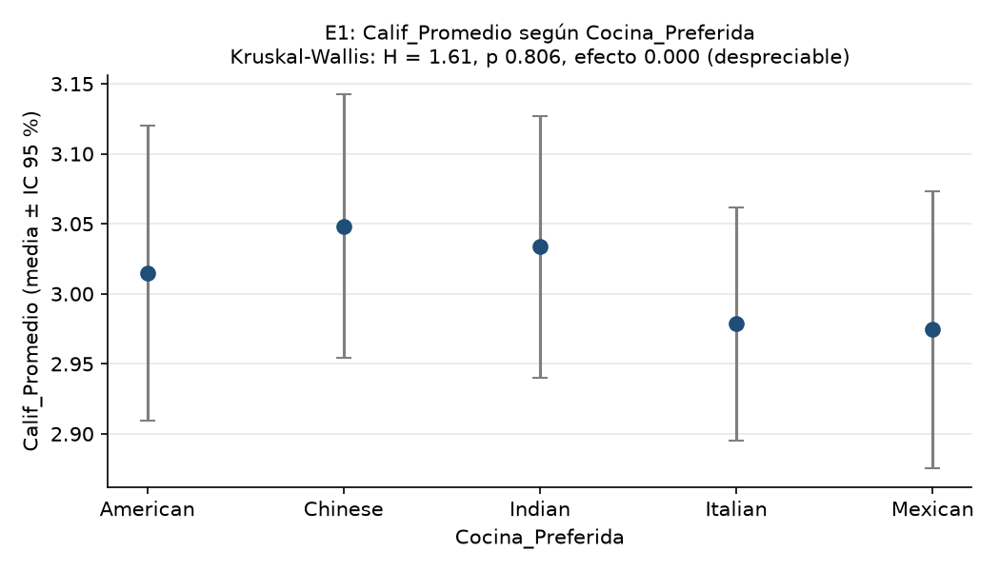

### E2. ¿La calificación promedio cambia según la ocasión?

- ANOVA: F = 0.819, p 0.441, η² = 0.0011
- Kruskal-Wallis: H = 1.648, p 0.439, ε² = 0.0000
- Supuestos: Shapiro-Wilk p < 0.001, Levene p 0.276
- Prueba principal: Kruskal-Wallis; p corregido (Holm) 1.000

| Grupo | n | Media | Desv. | Mediana |
|---|---:|---:|---:|---:|
| Business | 500 | 3.038 | 0.801 | 3.0 |
| Casual | 481 | 3.019 | 0.849 | 3.0 |
| Celebration | 519 | 2.973 | 0.856 | 3.0 |

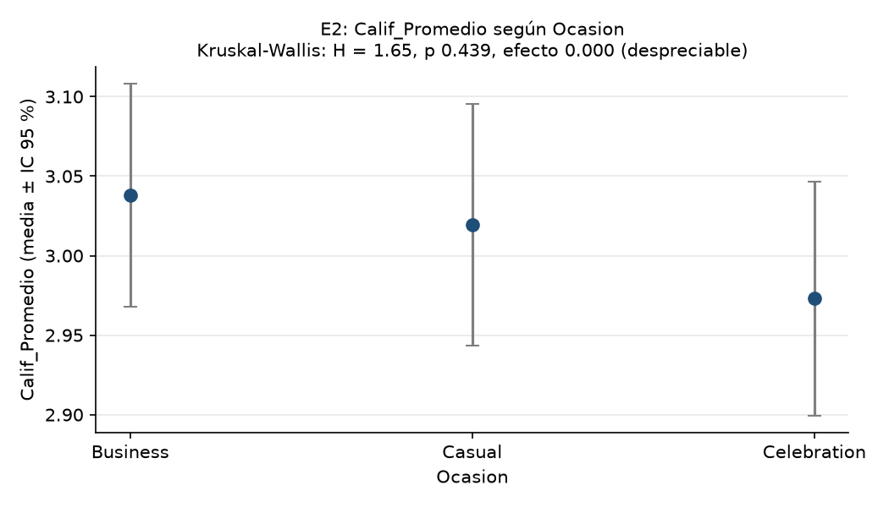

### E3. ¿La calificación promedio cambia según la franja de visita?

- ANOVA: F = 0.699, p 0.497, η² = 0.0009
- Kruskal-Wallis: H = 2.141, p 0.343, ε² = 0.0001
- Supuestos: Shapiro-Wilk p < 0.001, Levene p 0.545
- Prueba principal: Kruskal-Wallis; p corregido (Holm) 1.000

| Grupo | n | Media | Desv. | Mediana |
|---|---:|---:|---:|---:|
| Breakfast | 506 | 3.012 | 0.820 | 3.0 |
| Lunch | 502 | 2.977 | 0.852 | 3.0 |
| Dinner | 492 | 3.040 | 0.836 | 3.0 |

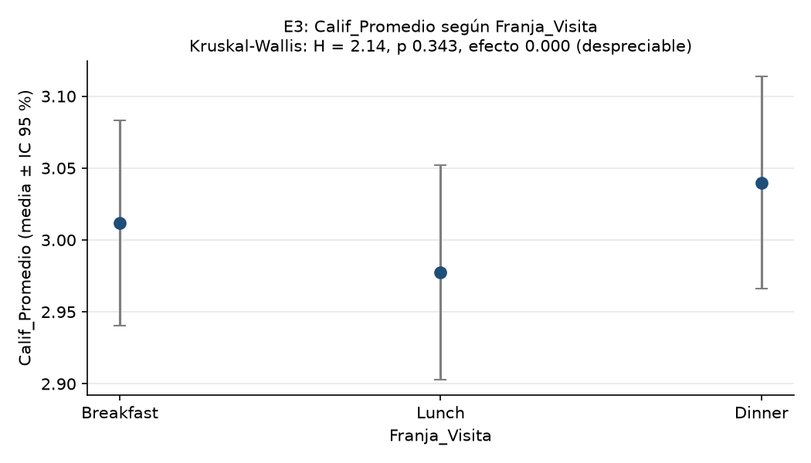

### E4. ¿La calificación promedio cambia según la frecuencia de visita?

- ANOVA: F = 2.277, p 0.078, η² = 0.0045
- Kruskal-Wallis: H = 6.110, p 0.106, ε² = 0.0021
- Supuestos: Shapiro-Wilk p < 0.001, Levene p 0.431
- Prueba principal: Kruskal-Wallis; p corregido (Holm) 1.000

| Grupo | n | Media | Desv. | Mediana |
|---|---:|---:|---:|---:|
| Daily | 153 | 2.950 | 0.857 | 3.0 |
| Weekly | 606 | 3.072 | 0.835 | 3.0 |
| Monthly | 428 | 2.943 | 0.810 | 3.0 |
| Rarely | 313 | 3.010 | 0.856 | 3.0 |

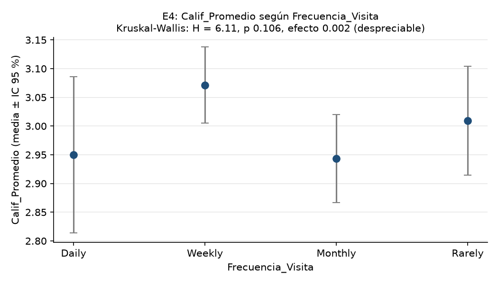

### E5. ¿La calificación de servicio cambia según la cocina preferida?

- ANOVA: F = 0.476, p 0.754, η² = 0.0013
- Kruskal-Wallis: H = 1.894, p 0.755, ε² = 0.0000
- Supuestos: Shapiro-Wilk p < 0.001, Levene p 0.130
- Prueba principal: Kruskal-Wallis; p corregido (Holm) 1.000

| Grupo | n | Media | Desv. | Mediana |
|---|---:|---:|---:|---:|
| American | 270 | 3.078 | 1.473 | 3.0 |
| Chinese | 310 | 3.052 | 1.416 | 3.0 |
| Indian | 296 | 3.118 | 1.398 | 3.0 |
| Italian | 325 | 3.003 | 1.371 | 3.0 |
| Mexican | 299 | 2.977 | 1.471 | 3.0 |

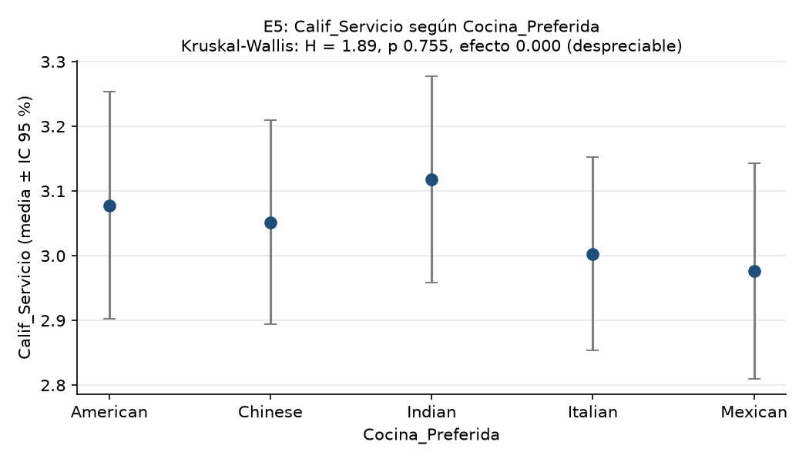

### E6. ¿La calificación de servicio cambia según la ocasión?

- ANOVA: F = 0.462, p 0.630, η² = 0.0006
- Kruskal-Wallis: H = 0.933, p 0.627, ε² = 0.0000
- Supuestos: Shapiro-Wilk p < 0.001, Levene p 0.254
- Prueba principal: Kruskal-Wallis; p corregido (Holm) 1.000

| Grupo | n | Media | Desv. | Mediana |
|---|---:|---:|---:|---:|
| Business | 500 | 3.094 | 1.440 | 3.0 |
| Casual | 481 | 3.019 | 1.393 | 3.0 |
| Celebration | 519 | 3.019 | 1.437 | 3.0 |

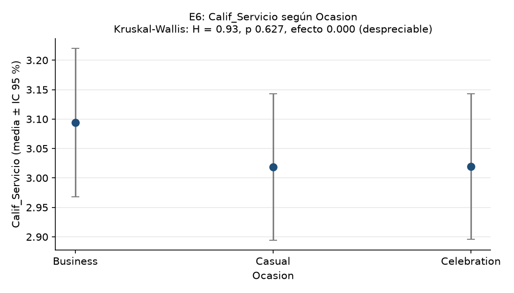

### E7. ¿La calificación de servicio cambia según la franja de visita?

- ANOVA: F = 0.174, p 0.840, η² = 0.0002
- Kruskal-Wallis: H = 0.355, p 0.837, ε² = 0.0000
- Supuestos: Shapiro-Wilk p < 0.001, Levene p 0.406
- Prueba principal: Kruskal-Wallis; p corregido (Holm) 1.000

| Grupo | n | Media | Desv. | Mediana |
|---|---:|---:|---:|---:|
| Breakfast | 506 | 3.014 | 1.426 | 3.0 |
| Lunch | 502 | 3.056 | 1.405 | 3.0 |
| Dinner | 492 | 3.063 | 1.442 | 3.0 |

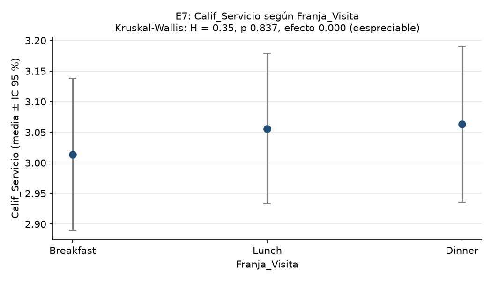

### E8. ¿La calificación de servicio cambia según la frecuencia de visita?

- ANOVA: F = 2.078, p 0.101, η² = 0.0041
- Kruskal-Wallis: H = 6.220, p 0.101, ε² = 0.0022
- Supuestos: Shapiro-Wilk p < 0.001, Levene p 0.636
- Prueba principal: Kruskal-Wallis; p corregido (Holm) 1.000

| Grupo | n | Media | Desv. | Mediana |
|---|---:|---:|---:|---:|
| Daily | 153 | 2.902 | 1.380 | 3.0 |
| Weekly | 606 | 3.089 | 1.439 | 3.0 |
| Monthly | 428 | 2.946 | 1.430 | 3.0 |
| Rarely | 313 | 3.160 | 1.396 | 3.0 |

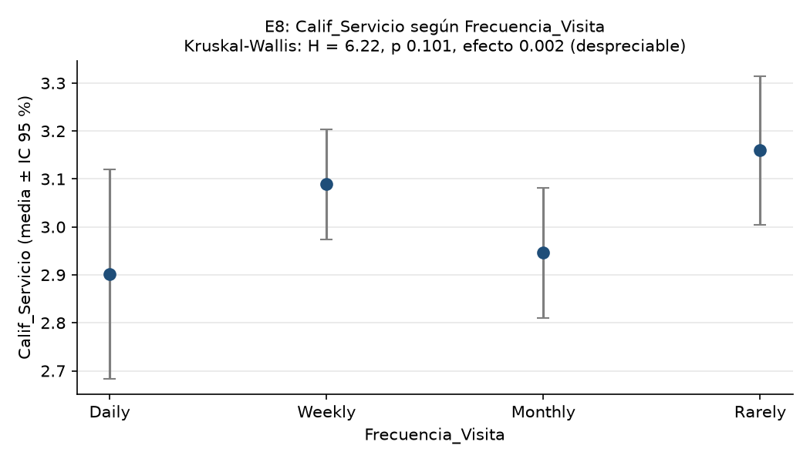

### E9. ¿La calificación de comida cambia según la cocina preferida?

- ANOVA: F = 1.078, p 0.366, η² = 0.0029
- Kruskal-Wallis: H = 4.294, p 0.368, ε² = 0.0002
- Supuestos: Shapiro-Wilk p < 0.001, Levene p 0.898
- Prueba principal: Kruskal-Wallis; p corregido (Holm) 1.000

| Grupo | n | Media | Desv. | Mediana |
|---|---:|---:|---:|---:|
| American | 270 | 3.081 | 1.417 | 3.0 |
| Chinese | 310 | 3.071 | 1.435 | 3.0 |
| Indian | 296 | 2.899 | 1.427 | 3.0 |
| Italian | 325 | 2.920 | 1.405 | 3.0 |
| Mexican | 299 | 3.027 | 1.409 | 3.0 |

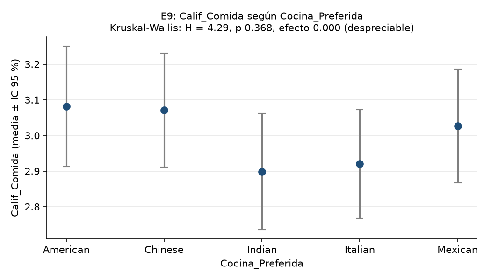

### E10. ¿La calificación de comida cambia según la ocasión?

- ANOVA: F = 0.413, p 0.662, η² = 0.0006
- Kruskal-Wallis: H = 0.832, p 0.660, ε² = 0.0000
- Supuestos: Shapiro-Wilk p < 0.001, Levene p 0.980
- Prueba principal: Kruskal-Wallis; p corregido (Holm) 1.000

| Grupo | n | Media | Desv. | Mediana |
|---|---:|---:|---:|---:|
| Business | 500 | 3.008 | 1.413 | 3.0 |
| Casual | 481 | 3.033 | 1.423 | 3.0 |
| Celebration | 519 | 2.954 | 1.423 | 3.0 |

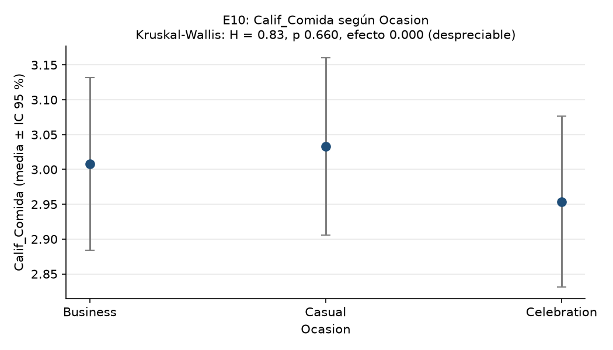

### E11. ¿La calificación de comida cambia según la franja de visita?

- ANOVA: F = 1.772, p 0.170, η² = 0.0024
- Kruskal-Wallis: H = 3.598, p 0.165, ε² = 0.0011
- Supuestos: Shapiro-Wilk p < 0.001, Levene p 0.238
- Prueba principal: Kruskal-Wallis; p corregido (Holm) 1.000

| Grupo | n | Media | Desv. | Mediana |
|---|---:|---:|---:|---:|
| Breakfast | 506 | 3.020 | 1.393 | 3.0 |
| Lunch | 502 | 2.904 | 1.417 | 3.0 |
| Dinner | 492 | 3.069 | 1.445 | 3.0 |

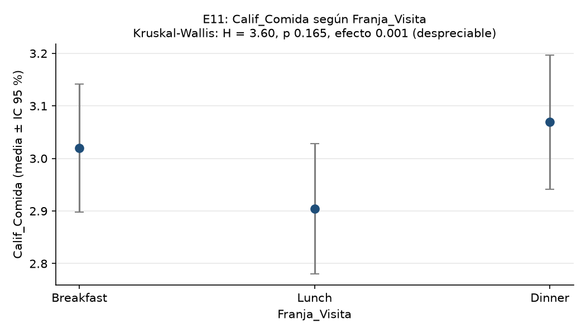

### E12. ¿La calificación de comida cambia según la frecuencia de visita?

- ANOVA: F = 3.604, p 0.013, η² = 0.0072
- Kruskal-Wallis: H = 10.796, p 0.013, ε² = 0.0052
- Supuestos: Shapiro-Wilk p < 0.001, Levene p 0.582
- Prueba principal: Kruskal-Wallis; p corregido (Holm) 0.219

| Grupo | n | Media | Desv. | Mediana |
|---|---:|---:|---:|---:|
| Daily | 153 | 2.941 | 1.457 | 3.0 |
| Weekly | 606 | 3.142 | 1.416 | 3.0 |
| Monthly | 428 | 2.900 | 1.396 | 3.0 |
| Rarely | 313 | 2.879 | 1.418 | 3.0 |

**Atención:** deja de ser significativa al corregir por comparaciones múltiples, así que los pares de abajo no deben tomarse como hallazgo.

Pares con diferencia significativa:

- Tukey HSD: Monthly vs Weekly (diferencia de medias +0.242, p ajustado 0.034)
- Tukey HSD: Rarely vs Weekly (diferencia de medias +0.263, p ajustado 0.038)
- Mann-Whitney (Holm): Weekly vs Monthly (diferencia de medias -0.242, p ajustado 0.036)
- Mann-Whitney (Holm): Weekly vs Rarely (diferencia de medias -0.263, p ajustado 0.040)

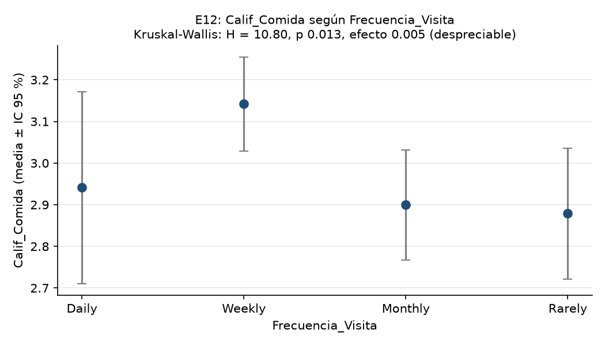

### E13. ¿La calificación de ambiente cambia según la cocina preferida?

- ANOVA: F = 0.898, p 0.464, η² = 0.0024
- Kruskal-Wallis: H = 3.700, p 0.448, ε² = 0.0000
- Supuestos: Shapiro-Wilk p < 0.001, Levene p 0.309
- Prueba principal: Kruskal-Wallis; p corregido (Holm) 1.000

| Grupo | n | Media | Desv. | Mediana |
|---|---:|---:|---:|---:|
| American | 270 | 2.885 | 1.413 | 3.0 |
| Chinese | 310 | 3.023 | 1.512 | 3.0 |
| Indian | 296 | 3.084 | 1.469 | 3.0 |
| Italian | 325 | 3.012 | 1.429 | 3.0 |
| Mexican | 299 | 2.920 | 1.424 | 3.0 |

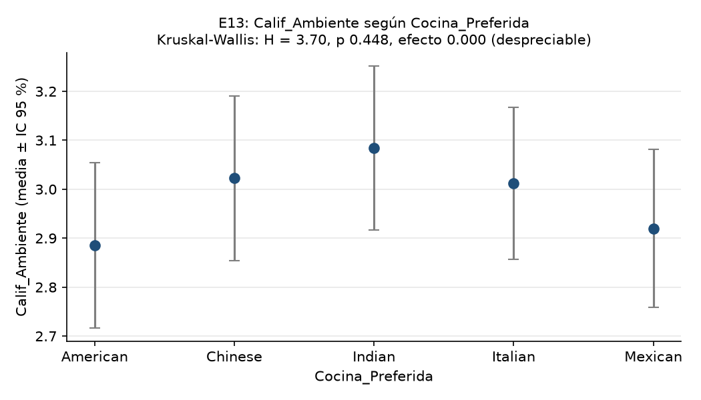

### E14. ¿La calificación de ambiente cambia según la ocasión?

- ANOVA: F = 0.323, p 0.724, η² = 0.0004
- Kruskal-Wallis: H = 0.680, p 0.712, ε² = 0.0000
- Supuestos: Shapiro-Wilk p < 0.001, Levene p 0.249
- Prueba principal: Kruskal-Wallis; p corregido (Holm) 1.000

| Grupo | n | Media | Desv. | Mediana |
|---|---:|---:|---:|---:|
| Business | 500 | 3.012 | 1.444 | 3.0 |
| Casual | 481 | 3.006 | 1.432 | 3.0 |
| Celebration | 519 | 2.946 | 1.476 | 3.0 |

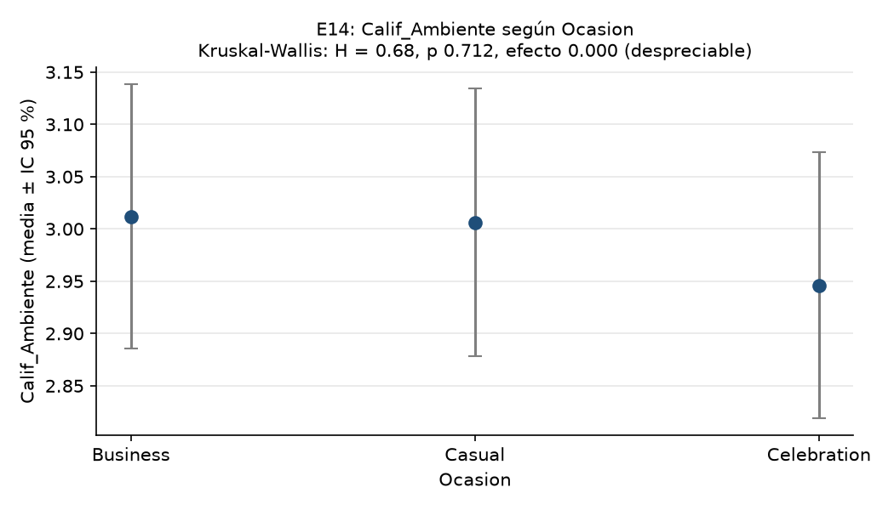

### E15. ¿La calificación de ambiente cambia según la franja de visita?

- ANOVA: F = 0.053, p 0.948, η² = 0.0001
- Kruskal-Wallis: H = 0.121, p 0.941, ε² = 0.0000
- Supuestos: Shapiro-Wilk p < 0.001, Levene p 0.022
- Prueba principal: Kruskal-Wallis; p corregido (Holm) 1.000

| Grupo | n | Media | Desv. | Mediana |
|---|---:|---:|---:|---:|
| Breakfast | 506 | 3.002 | 1.419 | 3.0 |
| Lunch | 502 | 2.972 | 1.500 | 3.0 |
| Dinner | 492 | 2.988 | 1.434 | 3.0 |

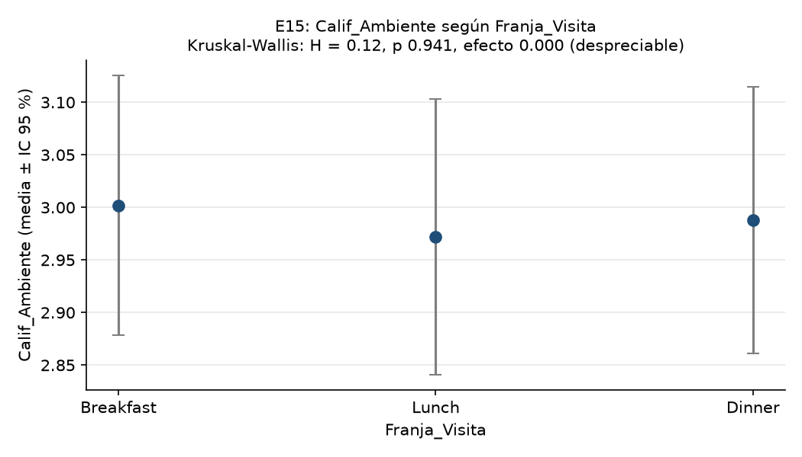

### E16. ¿La calificación de ambiente cambia según la frecuencia de visita?

- ANOVA: F = 0.012, p 0.998, η² = 0.0000
- Kruskal-Wallis: H = 0.037, p 0.998, ε² = 0.0000
- Supuestos: Shapiro-Wilk p < 0.001, Levene p 0.399
- Prueba principal: Kruskal-Wallis; p corregido (Holm) 1.000

| Grupo | n | Media | Desv. | Mediana |
|---|---:|---:|---:|---:|
| Daily | 153 | 3.007 | 1.440 | 3.0 |
| Weekly | 606 | 2.983 | 1.476 | 3.0 |
| Monthly | 428 | 2.984 | 1.456 | 3.0 |
| Rarely | 313 | 2.990 | 1.406 | 3.0 |

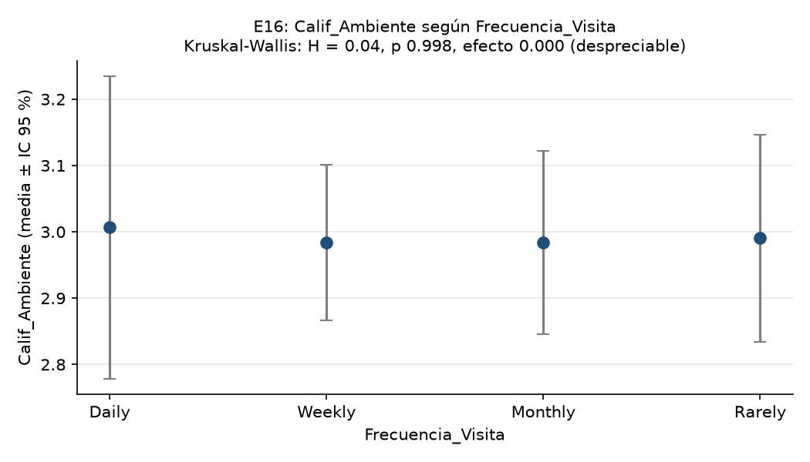

### E17. ¿El tiempo de espera cambia según la franja de visita?

- ANOVA: F = 2.059, p 0.128, η² = 0.0027
- Kruskal-Wallis: H = 4.119, p 0.128, ε² = 0.0014
- Supuestos: Shapiro-Wilk p < 0.001, Levene p 0.888
- Prueba principal: Kruskal-Wallis; p corregido (Holm) 1.000

| Grupo | n | Media | Desv. | Mediana |
|---|---:|---:|---:|---:|
| Breakfast | 506 | 30.904 | 17.241 | 30.9 |
| Lunch | 502 | 28.899 | 17.356 | 28.0 |
| Dinner | 492 | 30.693 | 17.002 | 31.1 |

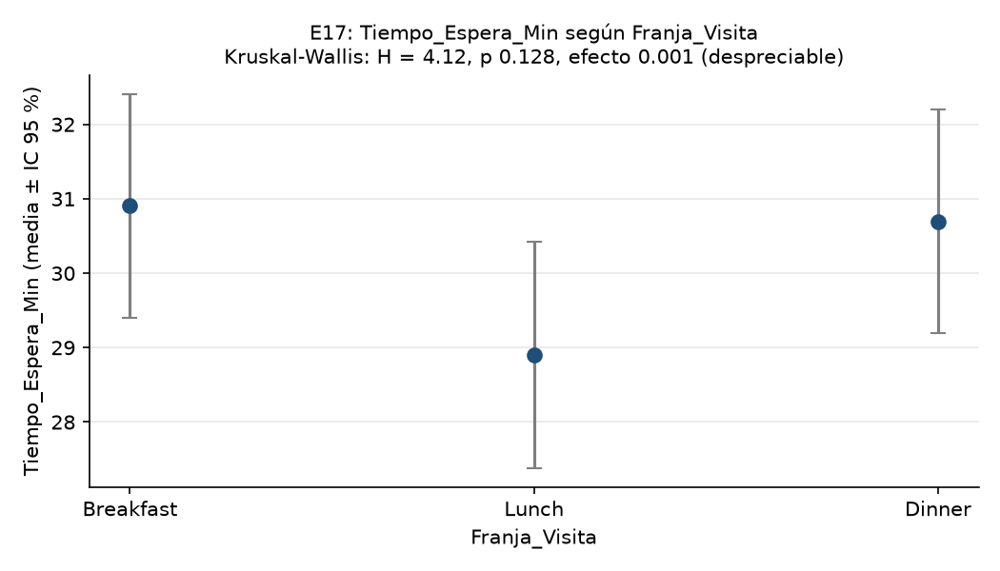

### R1. ¿El rating cambia según el nivel de precio?

- ANOVA: F = 122.740, p < 0.001, η² = 0.0047
- Kruskal-Wallis: H = 254.318, p < 0.001, ε² = 0.0049
- Supuestos: Shapiro-Wilk p < 0.001, Levene p < 0.001
- Prueba principal: Kruskal-Wallis; p corregido (Holm) < 0.001

| Grupo | n | Media | Desv. | Mediana |
|---|---:|---:|---:|---:|
| Económico | 4,856 | 3.827 | 1.483 | 5.0 |
| Medio | 43,991 | 3.849 | 1.397 | 4.0 |
| Alto | 3,073 | 4.251 | 1.153 | 5.0 |

Pares con diferencia significativa:

- Tukey HSD: Alto vs Económico (diferencia de medias -0.424, p ajustado < 0.001)
- Tukey HSD: Alto vs Medio (diferencia de medias -0.403, p ajustado < 0.001)
- Mann-Whitney (Holm): Económico vs Alto (diferencia de medias +0.424, p ajustado < 0.001)
- Mann-Whitney (Holm): Medio vs Alto (diferencia de medias +0.403, p ajustado < 0.001)

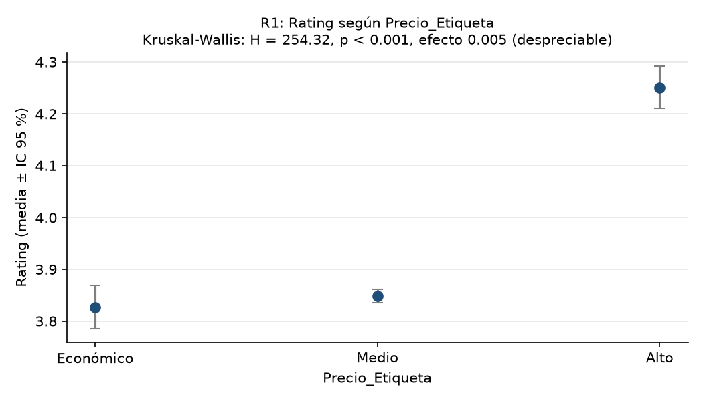

### R2. ¿El rating cambia según el año?

- ANOVA: F = 11.205, p < 0.001, η² = 0.0013
- Kruskal-Wallis: H = 93.660, p < 0.001, ε² = 0.0016
- Supuestos: Shapiro-Wilk p < 0.001, Levene p < 0.001
- Prueba principal: Kruskal-Wallis; p corregido (Holm) < 0.001

| Grupo | n | Media | Desv. | Mediana |
|---|---:|---:|---:|---:|
| 2017 | 12,143 | 3.892 | 1.263 | 4.0 |
| 2018 | 11,340 | 3.905 | 1.320 | 4.0 |
| 2019 | 10,268 | 3.853 | 1.394 | 4.0 |
| 2020 | 5,861 | 3.929 | 1.433 | 5.0 |
| 2021 | 5,103 | 3.808 | 1.543 | 5.0 |
| 2022 | 5,497 | 3.842 | 1.543 | 5.0 |
| 2023 | 3,170 | 3.727 | 1.598 | 5.0 |

Pares con diferencia significativa:

- Tukey HSD: 2017 vs 2021 (diferencia de medias -0.084, p ajustado 0.006)
- Tukey HSD: 2017 vs 2023 (diferencia de medias -0.165, p ajustado < 0.001)
- Tukey HSD: 2018 vs 2021 (diferencia de medias -0.096, p ajustado < 0.001)
- Tukey HSD: 2018 vs 2023 (diferencia de medias -0.178, p ajustado < 0.001)
- Tukey HSD: 2019 vs 2020 (diferencia de medias +0.076, p ajustado 0.016)
- Tukey HSD: 2019 vs 2023 (diferencia de medias -0.126, p ajustado < 0.001)
- Tukey HSD: 2020 vs 2021 (diferencia de medias -0.120, p ajustado < 0.001)
- Tukey HSD: 2020 vs 2022 (diferencia de medias -0.087, p ajustado 0.016)
- Tukey HSD: 2020 vs 2023 (diferencia de medias -0.202, p ajustado < 0.001)
- Tukey HSD: 2022 vs 2023 (diferencia de medias -0.115, p ajustado 0.004)
- Mann-Whitney (Holm): 2017 vs 2018 (diferencia de medias +0.013, p ajustado 0.013)
- Mann-Whitney (Holm): 2017 vs 2020 (diferencia de medias +0.037, p ajustado < 0.001)
- Mann-Whitney (Holm): 2017 vs 2021 (diferencia de medias -0.084, p ajustado < 0.001)
- Mann-Whitney (Holm): 2017 vs 2022 (diferencia de medias -0.050, p ajustado < 0.001)
- Mann-Whitney (Holm): 2018 vs 2020 (diferencia de medias +0.024, p ajustado < 0.001)
- Mann-Whitney (Holm): 2018 vs 2022 (diferencia de medias -0.063, p ajustado < 0.001)
- Mann-Whitney (Holm): 2019 vs 2020 (diferencia de medias +0.076, p ajustado < 0.001)
- Mann-Whitney (Holm): 2019 vs 2022 (diferencia de medias -0.011, p ajustado < 0.001)
- Mann-Whitney (Holm): 2020 vs 2023 (diferencia de medias -0.202, p ajustado 0.002)
- Mann-Whitney (Holm): 2022 vs 2023 (diferencia de medias -0.115, p ajustado 0.019)

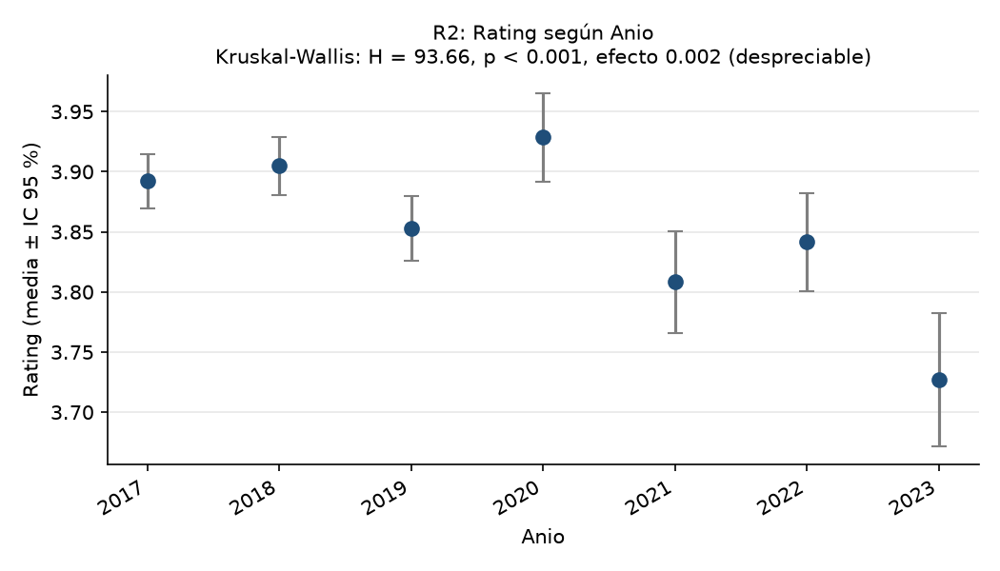

### R3. ¿El rating cambia según la cocina principal?

- ANOVA: F = 134.998, p < 0.001, η² = 0.0276
- Kruskal-Wallis: H = 1239.569, p < 0.001, ε² = 0.0258
- Supuestos: Shapiro-Wilk p < 0.001, Levene p < 0.001
- Prueba principal: Kruskal-Wallis; p corregido (Holm) < 0.001

| Grupo | n | Media | Desv. | Mediana |
|---|---:|---:|---:|---:|
| European | 2,210 | 4.210 | 1.196 | 5.0 |
| Japanese | 1,183 | 4.207 | 1.198 | 5.0 |
| Mexican | 1,830 | 4.142 | 1.356 | 5.0 |
| Mediterranean | 10,855 | 4.135 | 1.190 | 5.0 |
| Italian | 3,066 | 4.006 | 1.312 | 5.0 |
| Seafood | 3,755 | 3.954 | 1.346 | 4.0 |
| Steakhouse | 4,730 | 3.842 | 1.371 | 4.0 |
| American | 1,102 | 3.811 | 1.409 | 4.0 |
| Spanish | 15,728 | 3.671 | 1.470 | 4.0 |
| Bar | 1,246 | 3.559 | 1.510 | 4.0 |
| Coffee & Tea | 1,920 | 3.417 | 1.591 | 4.0 |

Pares con diferencia significativa:

- Tukey HSD: American vs Bar (diferencia de medias -0.252, p ajustado < 0.001)
- Tukey HSD: American vs Coffee & Tea (diferencia de medias -0.394, p ajustado < 0.001)
- Tukey HSD: American vs European (diferencia de medias +0.399, p ajustado < 0.001)
- Tukey HSD: American vs Italian (diferencia de medias +0.195, p ajustado 0.002)
- Tukey HSD: American vs Japanese (diferencia de medias +0.396, p ajustado < 0.001)
- Tukey HSD: American vs Mediterranean (diferencia de medias +0.324, p ajustado < 0.001)
- Tukey HSD: American vs Mexican (diferencia de medias +0.331, p ajustado < 0.001)
- Tukey HSD: American vs Spanish (diferencia de medias -0.140, p ajustado 0.039)
- Tukey HSD: Bar vs European (diferencia de medias +0.651, p ajustado < 0.001)
- Tukey HSD: Bar vs Italian (diferencia de medias +0.447, p ajustado < 0.001)
- Tukey HSD: Bar vs Japanese (diferencia de medias +0.648, p ajustado < 0.001)
- Tukey HSD: Bar vs Mediterranean (diferencia de medias +0.576, p ajustado < 0.001)
- Tukey HSD: Bar vs Mexican (diferencia de medias +0.583, p ajustado < 0.001)
- Tukey HSD: Bar vs Seafood (diferencia de medias +0.395, p ajustado < 0.001)
- Tukey HSD: Bar vs Steakhouse (diferencia de medias +0.283, p ajustado < 0.001)
- Tukey HSD: Coffee & Tea vs European (diferencia de medias +0.793, p ajustado < 0.001)
- Tukey HSD: Coffee & Tea vs Italian (diferencia de medias +0.589, p ajustado < 0.001)
- Tukey HSD: Coffee & Tea vs Japanese (diferencia de medias +0.790, p ajustado < 0.001)
- Tukey HSD: Coffee & Tea vs Mediterranean (diferencia de medias +0.718, p ajustado < 0.001)
- Tukey HSD: Coffee & Tea vs Mexican (diferencia de medias +0.725, p ajustado < 0.001)
- Tukey HSD: Coffee & Tea vs Seafood (diferencia de medias +0.537, p ajustado < 0.001)
- Tukey HSD: Coffee & Tea vs Spanish (diferencia de medias +0.254, p ajustado < 0.001)
- Tukey HSD: Coffee & Tea vs Steakhouse (diferencia de medias +0.425, p ajustado < 0.001)
- Tukey HSD: European vs Italian (diferencia de medias -0.204, p ajustado < 0.001)
- Tukey HSD: European vs Seafood (diferencia de medias -0.256, p ajustado < 0.001)
- Tukey HSD: European vs Spanish (diferencia de medias -0.539, p ajustado < 0.001)
- Tukey HSD: European vs Steakhouse (diferencia de medias -0.368, p ajustado < 0.001)
- Tukey HSD: Italian vs Japanese (diferencia de medias +0.201, p ajustado < 0.001)
- Tukey HSD: Italian vs Mediterranean (diferencia de medias +0.129, p ajustado < 0.001)
- Tukey HSD: Italian vs Mexican (diferencia de medias +0.136, p ajustado 0.030)
- Tukey HSD: Italian vs Spanish (diferencia de medias -0.335, p ajustado < 0.001)
- Tukey HSD: Italian vs Steakhouse (diferencia de medias -0.163, p ajustado < 0.001)
- Tukey HSD: Japanese vs Seafood (diferencia de medias -0.253, p ajustado < 0.001)
- Tukey HSD: Japanese vs Spanish (diferencia de medias -0.536, p ajustado < 0.001)
- Tukey HSD: Japanese vs Steakhouse (diferencia de medias -0.365, p ajustado < 0.001)
- Tukey HSD: Mediterranean vs Seafood (diferencia de medias -0.181, p ajustado < 0.001)
- Tukey HSD: Mediterranean vs Spanish (diferencia de medias -0.464, p ajustado < 0.001)
- Tukey HSD: Mediterranean vs Steakhouse (diferencia de medias -0.293, p ajustado < 0.001)
- Tukey HSD: Mexican vs Seafood (diferencia de medias -0.188, p ajustado < 0.001)
- Tukey HSD: Mexican vs Spanish (diferencia de medias -0.471, p ajustado < 0.001)
- Tukey HSD: Mexican vs Steakhouse (diferencia de medias -0.300, p ajustado < 0.001)
- Tukey HSD: Seafood vs Spanish (diferencia de medias -0.283, p ajustado < 0.001)
- Tukey HSD: Seafood vs Steakhouse (diferencia de medias -0.112, p ajustado 0.008)
- Tukey HSD: Spanish vs Steakhouse (diferencia de medias +0.172, p ajustado < 0.001)
- Mann-Whitney (Holm): European vs Mediterranean (diferencia de medias -0.075, p ajustado < 0.001)
- Mann-Whitney (Holm): European vs Italian (diferencia de medias -0.204, p ajustado < 0.001)
- Mann-Whitney (Holm): European vs Seafood (diferencia de medias -0.256, p ajustado < 0.001)
- Mann-Whitney (Holm): European vs Steakhouse (diferencia de medias -0.368, p ajustado < 0.001)
- Mann-Whitney (Holm): European vs American (diferencia de medias -0.399, p ajustado < 0.001)
- Mann-Whitney (Holm): European vs Spanish (diferencia de medias -0.539, p ajustado < 0.001)
- Mann-Whitney (Holm): European vs Bar (diferencia de medias -0.651, p ajustado < 0.001)
- Mann-Whitney (Holm): European vs Coffee & Tea (diferencia de medias -0.793, p ajustado < 0.001)
- Mann-Whitney (Holm): Japanese vs Mediterranean (diferencia de medias -0.072, p ajustado 0.014)
- Mann-Whitney (Holm): Japanese vs Italian (diferencia de medias -0.201, p ajustado < 0.001)
- Mann-Whitney (Holm): Japanese vs Seafood (diferencia de medias -0.253, p ajustado < 0.001)
- Mann-Whitney (Holm): Japanese vs Steakhouse (diferencia de medias -0.365, p ajustado < 0.001)
- Mann-Whitney (Holm): Japanese vs American (diferencia de medias -0.396, p ajustado < 0.001)
- Mann-Whitney (Holm): Japanese vs Spanish (diferencia de medias -0.536, p ajustado < 0.001)
- Mann-Whitney (Holm): Japanese vs Bar (diferencia de medias -0.648, p ajustado < 0.001)
- Mann-Whitney (Holm): Japanese vs Coffee & Tea (diferencia de medias -0.790, p ajustado < 0.001)
- Mann-Whitney (Holm): Mexican vs Mediterranean (diferencia de medias -0.007, p ajustado < 0.001)
- Mann-Whitney (Holm): Mexican vs Italian (diferencia de medias -0.136, p ajustado < 0.001)
- Mann-Whitney (Holm): Mexican vs Seafood (diferencia de medias -0.188, p ajustado < 0.001)
- Mann-Whitney (Holm): Mexican vs Steakhouse (diferencia de medias -0.300, p ajustado < 0.001)
- Mann-Whitney (Holm): Mexican vs American (diferencia de medias -0.331, p ajustado < 0.001)
- Mann-Whitney (Holm): Mexican vs Spanish (diferencia de medias -0.471, p ajustado < 0.001)
- Mann-Whitney (Holm): Mexican vs Bar (diferencia de medias -0.583, p ajustado < 0.001)
- Mann-Whitney (Holm): Mexican vs Coffee & Tea (diferencia de medias -0.725, p ajustado < 0.001)
- Mann-Whitney (Holm): Mediterranean vs Italian (diferencia de medias -0.129, p ajustado 0.003)
- Mann-Whitney (Holm): Mediterranean vs Seafood (diferencia de medias -0.181, p ajustado < 0.001)
- Mann-Whitney (Holm): Mediterranean vs Steakhouse (diferencia de medias -0.293, p ajustado < 0.001)
- Mann-Whitney (Holm): Mediterranean vs American (diferencia de medias -0.324, p ajustado < 0.001)
- Mann-Whitney (Holm): Mediterranean vs Spanish (diferencia de medias -0.464, p ajustado < 0.001)
- Mann-Whitney (Holm): Mediterranean vs Bar (diferencia de medias -0.576, p ajustado < 0.001)
- Mann-Whitney (Holm): Mediterranean vs Coffee & Tea (diferencia de medias -0.718, p ajustado < 0.001)
- Mann-Whitney (Holm): Italian vs Steakhouse (diferencia de medias -0.163, p ajustado < 0.001)
- Mann-Whitney (Holm): Italian vs American (diferencia de medias -0.195, p ajustado 0.002)
- Mann-Whitney (Holm): Italian vs Spanish (diferencia de medias -0.335, p ajustado < 0.001)
- Mann-Whitney (Holm): Italian vs Bar (diferencia de medias -0.447, p ajustado < 0.001)
- Mann-Whitney (Holm): Italian vs Coffee & Tea (diferencia de medias -0.589, p ajustado < 0.001)
- Mann-Whitney (Holm): Seafood vs Steakhouse (diferencia de medias -0.112, p ajustado < 0.001)
- Mann-Whitney (Holm): Seafood vs American (diferencia de medias -0.143, p ajustado 0.033)
- Mann-Whitney (Holm): Seafood vs Spanish (diferencia de medias -0.283, p ajustado < 0.001)
- Mann-Whitney (Holm): Seafood vs Bar (diferencia de medias -0.395, p ajustado < 0.001)
- Mann-Whitney (Holm): Seafood vs Coffee & Tea (diferencia de medias -0.537, p ajustado < 0.001)
- Mann-Whitney (Holm): Steakhouse vs Spanish (diferencia de medias -0.172, p ajustado < 0.001)
- Mann-Whitney (Holm): Steakhouse vs Bar (diferencia de medias -0.283, p ajustado < 0.001)
- Mann-Whitney (Holm): Steakhouse vs Coffee & Tea (diferencia de medias -0.425, p ajustado < 0.001)
- Mann-Whitney (Holm): American vs Spanish (diferencia de medias -0.140, p ajustado 0.010)
- Mann-Whitney (Holm): American vs Bar (diferencia de medias -0.252, p ajustado < 0.001)
- Mann-Whitney (Holm): American vs Coffee & Tea (diferencia de medias -0.394, p ajustado < 0.001)
- Mann-Whitney (Holm): Spanish vs Bar (diferencia de medias -0.112, p ajustado 0.040)
- Mann-Whitney (Holm): Spanish vs Coffee & Tea (diferencia de medias -0.254, p ajustado < 0.001)

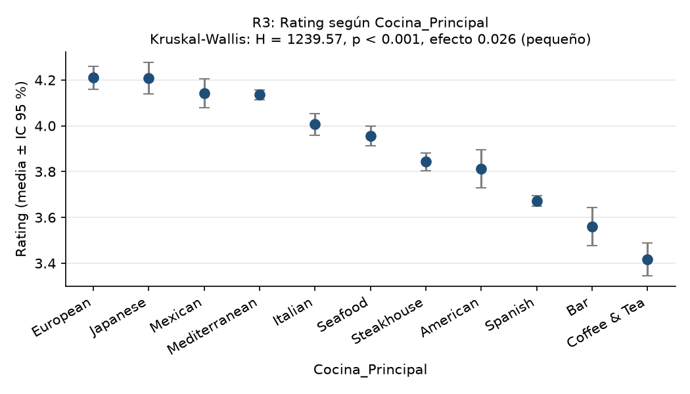
